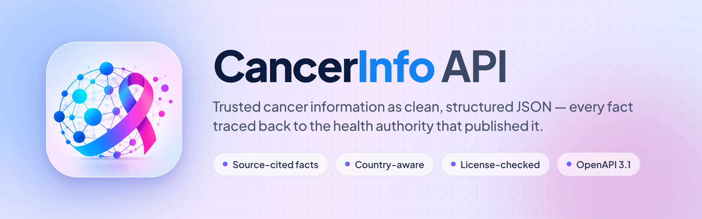
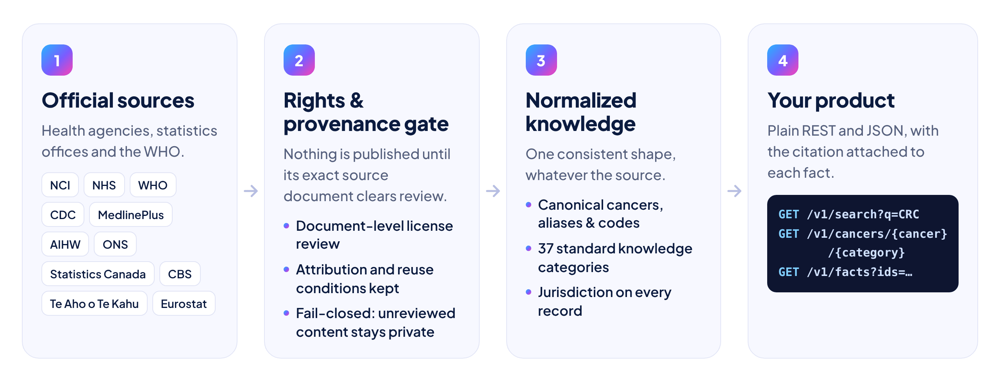

<div align="center">

<picture>
  <source media="(prefers-color-scheme: dark)" srcset=".github/assets/banner-dark.png">
  
</picture>

<br>

[](https://github.com/prakash426/CancerInfo-API/actions/workflows/ci.yml)
[](.python-version)
[](https://fastapi.tiangolo.com)
[](https://cancerinfo-api.onrender.com/openapi.json)
[](LICENSE)

**[Live API](https://cancerinfo-api.onrender.com)** &nbsp;·&nbsp;
**[Interactive docs](https://cancerinfo-api.onrender.com/docs)** &nbsp;·&nbsp;
**[Quickstart](#-try-it-in-10-seconds)** &nbsp;·&nbsp;
**[Endpoints](#-endpoints)** &nbsp;·&nbsp;
**[Documentation](docs/README.md)**

</div>

<br>

Cancer information on the web is scattered, inconsistent and hard to trace. **CancerInfo API** turns content from national health agencies and the World Health Organization into one predictable JSON shape — and every fact arrives with **who published it, where, for which country, and under what reuse terms**.

Build patient-education apps, health-literacy tools, research dashboards or AI assistants on data you can cite.

## ⚡ Try it in 10 seconds

No key, no signup:

```bash
curl "https://cancerinfo-api.onrender.com/v1/cancers/breast-cancer/symptoms?country=US"
```

<details>
<summary><b>See the response</b> (trimmed)</summary>

```jsonc
{
  "data": {
    "cancer": { "slug": "breast-cancer", "canonical_name": "Breast Cancer", "…": "…" },
    "category": "symptoms",
    "records": [
      {
        "id": "47567f24-2d21-4ab3-929b-6fc95ccfe758",
        "content": "Symptoms of breast cancer include a new lump or thickening in the breast or underarm, changes in the…",
        "jurisdiction": { "scope": "COUNTRY", "country": "US", "region": null },
        "audience": "patient",
        "sources": [
          {
            "source_id": "nci-us",
            "organization": "National Cancer Institute",
            "url": "https://www.cancer.gov/types/breast/symptoms",
            "document_title": "Breast Cancer Symptoms - NCI",
            "trust_tier": "Tier 1 - Primary Authoritative",
            "last_verified_at": "2026-09-12T06:23:36.483694Z",
            "attribution_text": "Adapted from National Cancer Institute text. …",
            "reuse_conditions": "Text/data only. Preserve source title, URL, attribution and licence conditions. …"
          }
        ]
      }
    ]
  },
  "meta": { "api_version": "v1", "result_count": 1, "disclaimer": "…" },
  "pagination": { "page": 1, "limit": 50, "total_records": 1, "has_next": false }
}
```

</details>

> [!NOTE]
> The hosted API sleeps when idle. If the first request takes a few seconds, it is waking up; the next ones are fast.

A few more to explore:

```bash
# Same cancer, different country: UK records come from the NHS
curl "https://cancerinfo-api.onrender.com/v1/cancers/ovarian-cancer/symptoms?country=GB"

# Abbreviations and aliases resolve: CRC → colorectal cancer
curl "https://cancerinfo-api.onrender.com/v1/search?q=CRC"

# What exists for a cancer, by category and country
curl "https://cancerinfo-api.onrender.com/v1/cancers/ovarian-cancer/sections"
```

## ✨ Why CancerInfo API

- **Every fact is cited.** Each record carries its source organization, exact document URL and title, verification date, attribution text and reuse conditions. Nothing is anonymous.
- **Country-aware by design.** Screening ages and guidance differ between countries. Every record states its jurisdiction, and `?country=` returns that country's records plus global ones, the country first.
- **Rights-checked before publishing.** Content is published only after its exact source document clears a license review. Anything unreviewed stays private, so the API fails closed rather than open.
- **One shape for everything.** Canonical cancer names, aliases and codes (ICD-O-3, MeSH, SNOMED CT where available), 37 standard knowledge categories, consistent pagination and a single error envelope.
- **Developer-first.** OpenAPI 3.1 contract, interactive Swagger and ReDoc, a Postman collection, request IDs and rate-limit headers on every response.

<picture>
  <source media="(prefers-color-scheme: dark)" srcset=".github/assets/how-it-works-dark.png">
  
</picture>

## 🧭 Endpoints

Base URL: `https://cancerinfo-api.onrender.com`

| Endpoint | What it returns |
| :--- | :--- |
| `GET /v1/cancers` | All cancers in the taxonomy, paginated, filterable by `site` |
| `GET /v1/cancers/{cancer}` | One cancer: canonical name, aliases, codes and the categories that have content |
| `GET /v1/cancers/{cancer}/{category}` | **The core route.** Cited records for one category, filterable by `country`, `audience`, `language` |
| `GET /v1/cancers/{cancer}/sections` | Which categories have content, with record counts and countries |
| `GET /v1/cancers/{cancer}/sources` | The sources behind a cancer's published records |
| `GET /v1/cancers/{cancer}/versions` | Version history with per-version source notices |
| `GET /v1/search?q=` | Search across cancers, aliases, abbreviations and content, with filters |
| `GET /v1/facts?ids=` | Re-check up to 50 saved record IDs, so cited content in your app stays current |
| `GET /v1/categories` | The 37 standard knowledge categories |
| `GET /v1/sources` · `/v1/sources/{id}` | The source registry: organization, country, license and attribution rules |
| `GET /v1/countries` | Countries and jurisdictions in the knowledge base |
| `GET /v1/coverage` | Published record and source counts, overall or for one `cancer` |
| `GET /v1/health` · `/v1/ready` | Service health and database readiness |

`{cancer}` accepts a slug (`breast-cancer`), an ID, the canonical name or a reviewed alias. `{category}` accepts any of the [37 categories](https://cancerinfo-api.onrender.com/v1/categories), such as `symptoms`, `screening`, `treatment`, `staging` or `statistics`.

Full request and response schemas: **[Swagger UI](https://cancerinfo-api.onrender.com/docs)** · **[ReDoc](https://cancerinfo-api.onrender.com/redoc)** · **[OpenAPI JSON](https://cancerinfo-api.onrender.com/openapi.json)** · **[Postman collection](rapidapi/postman_collection.json)**

## 🧑‍💻 Use it from code

**Python**

```python
import requests

BASE = "https://cancerinfo-api.onrender.com/v1"

resp = requests.get(f"{BASE}/cancers/ovarian-cancer/symptoms", params={"country": "GB"}, timeout=30)
resp.raise_for_status()

for record in resp.json()["data"]["records"]:
    print(record["content"][:120], "…")
    for source in record["sources"]:
        print("   ↳", source["organization"], source["url"])
```

**JavaScript / TypeScript**

```ts
const BASE = "https://cancerinfo-api.onrender.com/v1";

const res = await fetch(`${BASE}/search?q=${encodeURIComponent("bowel cancer")}`);
if (!res.ok) throw new Error(`CancerInfo API error ${res.status}`);

const { data } = await res.json();
for (const hit of data.results) {
  console.log(hit.match_type, hit.cancer?.canonical_name, hit.snippet);
}
```

More languages (Go, Kotlin, Swift) are in the [usage guide](docs/USAGE_GUIDE.md).

## 🏛️ Sources

Every published record traces back to one of these organizations. Each source's license and attribution rules travel with the data.

| Source | Country | Content license |
| :--- | :---: | :--- |
| National Cancer Institute (NCI) | 🇺🇸 | Public domain (U.S. government work) |
| Centers for Disease Control and Prevention (CDC) | 🇺🇸 | Public domain (U.S. government work) |
| MedlinePlus, National Library of Medicine | 🇺🇸 | Public domain for its own summaries; some sections licensed separately |
| National Health Service (NHS) | 🇬🇧 | Open Government Licence v3.0 |
| Office for National Statistics (ONS) | 🇬🇧 | Open Government Licence for covered material |
| Australian Institute of Health and Welfare (AIHW) | 🇦🇺 | CC BY 4.0, unless a separate notice applies |
| Statistics Canada | 🇨🇦 | Statistics Canada Open Licence |
| Statistics Netherlands (CBS) | 🇳🇱 | Creative Commons attribution |
| Te Aho o Te Kahu, Cancer Control Agency | 🇳🇿 | CC BY 4.0 by default, with noted exceptions |
| Eurostat | 🇪🇺 | Reuse permitted with exceptions; EU editorial content CC BY 4.0 |
| World Health Organization (WHO) | 🌐 | CC BY-NC-SA 3.0 IGO, **noncommercial only** |

The live registry, with full reuse policies, is at [`/v1/sources`](https://cancerinfo-api.onrender.com/v1/sources). WHO content is served only to approved noncommercial access and never on the default commercial path. Details: [content rights and attribution](docs/CONTENT_RIGHTS_AND_ATTRIBUTION.md).

### Coverage

The taxonomy holds **25 cancer types** across **37 knowledge categories**. Reviewed content is published progressively, so depth varies by cancer and country. Ask the API what is available rather than assuming:

```bash
# Categories, record counts and countries for one cancer
curl "https://cancerinfo-api.onrender.com/v1/cancers/ovarian-cancer/sections"

# Published records and sources for one cancer
curl "https://cancerinfo-api.onrender.com/v1/coverage?cancer=ovarian-cancer"
```

## 💡 What you can build

- **Patient and caregiver education** that shows the official source and country next to every statement
- **AI assistants and RAG pipelines** grounded in citable records, with `/v1/facts` to re-validate what you stored
- **Health-literacy and translation tools** that start from authoritative, attributable text
- **Research and public-health dashboards** built on the statistics categories from national statistics offices

> [!IMPORTANT]
> CancerInfo API provides public information for developers, researchers and caregivers. **It does not diagnose, recommend treatment, select or dose medication, or replace a qualified clinician.** Show your users the source and jurisdiction of every record, and direct medical questions to a doctor.

## 🛠️ Run it yourself

**Requirements:** Python 3.11. SQLite works for development; production uses PostgreSQL.

```bash
git clone https://github.com/prakash426/CancerInfo-API.git
cd CancerInfo-API

python3.11 -m venv .venv && source .venv/bin/activate
pip install --require-hashes -r requirements.txt

export DATABASE_URL=sqlite:////tmp/cancerinfo-dev.db
alembic upgrade head          # create the schema
python scripts/bootstrap.py   # load the baseline taxonomy and source registry

uvicorn app.main:app --reload --port 3000
```

Open <http://localhost:3000/docs>. A fresh development database keeps unreviewed content private, so most content routes return empty lists until reviewed records are loaded.

<details>
<summary><b>Docker</b></summary>

```bash
docker compose up -d                 # http://localhost:3000
PORT=8080 docker compose up -d       # any port
```

SQLite data persists in the `cancerinfo_data` volume. For production, set `ENVIRONMENT=production` and a PostgreSQL `DATABASE_URL`. Startup never creates tables or seeds data; schema changes go through Alembic, and the app refuses to start on an outdated schema. See [migrations and initialization](docs/MIGRATIONS_AND_INITIALIZATION.md).

</details>

<details>
<summary><b>Tests</b></summary>

```bash
DATABASE_URL=sqlite:////tmp/cancerinfo-tests.db python -m pytest tests/ -q
```

CI runs the full suite on SQLite and PostgreSQL, checks migrations for drift, exercises the bootstrap CLI and validates the Docker image. See [testing and validation](docs/VALIDATION_GUIDE.md).

</details>

### Built with

FastAPI · Pydantic v2 · SQLAlchemy 2.0 · Alembic · PostgreSQL (Neon) · Uvicorn · Docker · hosted on Render

## 🤝 Contributing

Contributions are welcome, especially new authoritative sources, aliases and abbreviations, taxonomy improvements and client libraries. Start with the [contributing guide](CONTRIBUTING.md) and the [code of conduct](CODE_OF_CONDUCT.md). Found an outdated or incorrect citation? [Open an issue](https://github.com/prakash426/CancerInfo-API/issues/new/choose).

## 📄 License

The **code** is released under the [MIT License](LICENSE). The **content** remains under each source's own license, shown above and returned with every record. Keep the attribution and reuse conditions when you display it.

## 💜 The story behind it

Within a short span, both of my parents were diagnosed with cancer. Late at night, between their treatments, I searched for answers and kept hitting the same walls: conflicting advice, guidance that differed by country with no way to tell which applied to us, and no simple way to see where a claim came from.

As an engineer, I wanted the opposite: one place where every fact names its source. CancerInfo API is that place, built in the open so others can use it too.

*To my mom and dad, and to every family going through the same thing.*

<div align="center">
<br>

**If CancerInfo API helps your work, a ⭐ helps other developers find it.**

</div>
